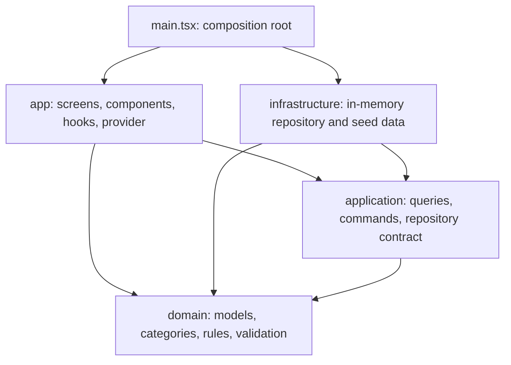

# WerfLog architecture

WerfLog is a client-side React prototype with three routes. Its data is held in
memory for one browser session. Refreshing the page restores the seed data.



## Responsibilities

| Location | Responsibility |
| --- | --- |
| `src/domain/` | Framework-independent models, category definitions, overdue rules, filtering, urgency ordering, summaries and form validation. |
| `src/application/` | Project and backoffice queries, status-change command and the repository contract. Accepts data and dependencies explicitly. |
| `src/infrastructure/` | Seed fixtures and the in-memory repository. Owns writes, stable snapshots and change notifications. |
| `src/app/providers/` | Injects the repository and subscribes React to snapshots with `useSyncExternalStore`. |
| `src/app/hooks/` | Connects queries to React and manages the new-item form workflow. |
| `src/app/screens/` | Routes, layout, navigation and local interaction state. |
| `src/app/components/` | Reusable presentation, report rendering, map integration and form markup. `ui/` contains the existing UI primitives. |
| `src/main.tsx` | Composition root: constructs one repository per browser session and injects it into the app. |

Dependencies point toward the domain. Domain and application code must not import
React, browser APIs, seed fixtures or infrastructure. Presentation must not import
infrastructure. `tests/architecture.test.mjs` checks these boundaries.

## Data flow

A screen reads a view hook, which runs an application query over a repository
snapshot. The query uses domain rules to derive the view. UI selections and
filters stay local; shared records live in the repository.

A status change follows `screen → changeItemStatus → repository`. The adapter
creates a new snapshot and notifies subscribers. React updates all readers from
that snapshot. Screens never mutate records or fixtures; selected records are
looked up by ID to avoid stale copies.

The Leaflet component owns its imperative map lifecycle and browser geolocation.
Business rules such as overdue detection remain in the domain. Its map-click
callback follows current React state without recreating the map.

## Scope and extension points

- The repository contract is intentionally synchronous and session-scoped. A
  remote API needs an explicit asynchronous loading/error and mutation lifecycle;
  it cannot simply be substituted without that work.
- The new-item dialog retains the original prototype behavior: it validates input
  and shows a success toast, but does not create a record. Implementing creation
  requires an application command, a repository operation and a deadline policy.
- Attachments and export are still UI placeholders. There is no authentication,
  backend, durable persistence or SharePoint integration.
- Keep business rules in `domain`, use cases and projections in `application`,
  external storage in `infrastructure`, and view behavior in `app`. Avoid adding
  interfaces or services when there is no separate responsibility to isolate.

## Verification

Use Node.js 24 for the built-in test runner's TypeScript support.

```sh
npm test
npm run typecheck
npm run build
```

Tests cover overdue boundaries, combined filters, ordering without mutation,
validation, project summaries, report totals, status changes, independent data
instances, subscription cleanup, rejected commands and layer dependency rules.

## Internal complexity assessment

Qualitative engineering judgment; 1 is very simple and 10 is very complex.

| Area | Rating | Reason |
| --- | --- | --- |
| Domain logic | 2/10 | Small set of pure rules and simple entities. |
| Application/data flow | 3/10 | Explicit queries and commands over one synchronous store. |
| Presentation | 5/10 | Multi-step form, Leaflet lifecycle, several views and charts. |
| Overall | 4/10 | Small application with moderate UI complexity and no distributed backend. |

The main remaining maintenance cost is the amount of JSX in the project and
backoffice screens, plus the broad generated UI/dependency surface. The layer
boundaries reduce coupling; they do not remove that existing surface area.
